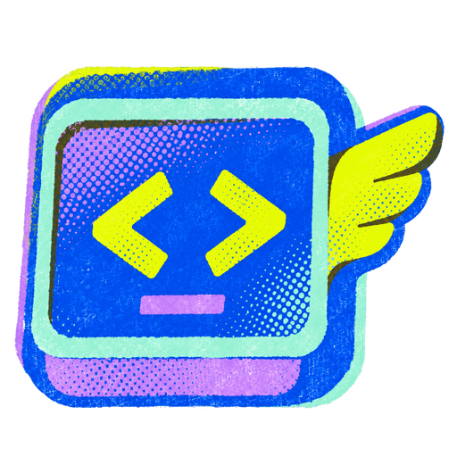

<p align="center">
  
</p>

<h1 align="center">Cockpit Code</h1>

<p align="center">A terminal coding agent written in Rust: interactive TUI, headless runs, and an ACP server for your editor. Bring any model provider.</p>

<p align="center">
  <a href="LICENSE"></a>
  <a href="https://github.com/FlyCockpit/cockpit-code/releases"></a>
  <a href="https://www.rust-lang.org/tools/install"></a>
  <a href="https://github.com/FlyCockpit"></a>
</p>

Cockpit Code (`cockpit-code`) is a coding agent you can use in three ways. You can work with it interactively in a full-screen terminal UI, run it as a one-shot command in scripts and CI, or connect it to an editor over the [Agent Client Protocol](https://agentclientprotocol.com). All three share one engine. It talks to Anthropic, OpenAI-compatible (Chat Completions or Responses) and any other model you can wrap in a small command-line adapter. Configuration is plain JSON files, and secrets stay in environment variables.

## Features

- **Terminal UI** (the default when you run `cockpit-code`). It has slash commands for models, reasoning effort, permissions, diffs, cost, usage, jobs, MCP servers and more. Type `/help` to list them.
- **Headless mode**: `cockpit-code -p "task"` runs one task and exits. Add `--json` for machine-readable output, or `--goal` to run the prompt as an autonomous goal (`cockpit-code -p "objective" --goal`).
- **ACP server**: `cockpit-code acp` serves the Agent Client Protocol (v1) on stdio for editors such as Zed.
- **Any provider**: native `anthropic`, `openai-chat` and `openai-responses` dialects, plus **command providers** that wrap any executable (a subscription CLI, a gateway or a script) behind a small JSONL protocol. Model discovery, cost tracking and per-provider usage and budget readers are built in.
- **Subagents**: agents can delegate to child agents in a tree or a flat one-level layout. Each child can use a different model. `/agents` shows the live agent tree.
- **Goals**: `/goal <text>` works autonomously against an agreed contract, with spending, time and token limits and an optional review panel.
- **Permissions**: four modes. `manual` asks you before each gated action. `auto` and `unattended` let a configurable safety model review the action. `yolo` skips the gate. Approvals can be granted once or for the whole session.
- **MCP**: connect Model Context Protocol servers over `stdio`, `http` or `sse`.
- **LSP**: navigation and post-edit diagnostics use the language servers you already have installed for Rust, JS/TS, Python, Go and C/C++. cockpit-code never downloads servers, and you can override or add servers in config.
- **Sessions**: every session is saved to disk. Resume one with `--resume <id>` or `--continue`, fork it with `--fork <id>[@point]`, and list them with `cockpit-code sessions`. Compact or prune long histories from the TUI or the CLI.
- **Shell and jobs**: commands run in pipes or a PTY. Long-running commands become background jobs that you and the agent can inspect, send input to or kill.
- **User terminals**: in the TUI, an agent can hand you a private terminal in a right-hand sidebar, for example to log in or type a password. Press `ctrl+]` to type in it and use `/terminal` to show or hide it. You decide what output, if any, the agent sees.
- **Extras**: web search and fetch (Firecrawl or TinyFish), a sandboxed Python `script` tool for multi-step tool calls, skills from `~/.agents/skills`, file attachments such as images and PDFs (`--attach` in headless mode), vim keys, and themes.

## How it works

Cockpit Code is a Rust workspace. One in-process agent engine (`code-engine`) handles sessions, tools, models, permissions, MCP, LSP and subagents, and three front ends share it: the terminal UI (`code-tui`), the ACP stdio server (`code-acp`) and the `cockpit-code` binary, which also runs headless tasks. `code-config` loads and validates the configuration. Model requests go directly to HTTP providers or, for command providers, to an executable you supply.

## Quick start

```sh
# 0. Install the binary (see Installation)

# 1. Scaffold config: a provider template that reads its key from an env var
cockpit-code init --provider anthropic --key-env ANTHROPIC_API_KEY

# 2. Add a model to the provider file (see Configuration), then check that it loads
export ANTHROPIC_API_KEY=...
cockpit-code doctor

# 3. Run
cockpit-code                          # interactive TUI
cockpit-code -p "fix the failing test" # headless, one task
```

`init` provider templates are `openrouter`, `openrouter-anthropic`, `openai`, `openai-chat`, `anthropic` and `command`. Repeat `--provider` to add several. Other useful flags are `--default-model provider/model`, `--default-mode manual|auto|unattended|yolo` and `--safety-model provider/model`. Existing files are kept unless you pass `--force`. `init` never writes a secret. It only writes a `${VAR}` reference.

## Installation

### Prebuilt binaries

HTTPS uses the operating system's certificate store, and falls back to bundled Mozilla root certificates when none is available.

Each [GitHub release](https://github.com/FlyCockpit/cockpit-code/releases) has `cockpit-code-<version>-<target>.tar.gz` archives for Linux (`x86_64-unknown-linux-musl`, `aarch64-unknown-linux-musl`) and macOS (`aarch64-apple-darwin`, `x86_64-apple-darwin`), a `SHA256SUMS` file and the third-party license notices. The Linux binaries are statically linked with musl, so they run on any distribution, glibc or musl based. Download the archive for your platform, check it and put the binary on your `PATH`:

```sh
VERSION=1.0.0
TARGET=x86_64-unknown-linux-musl   # or aarch64-unknown-linux-musl, aarch64-apple-darwin, x86_64-apple-darwin
BASE=https://github.com/FlyCockpit/cockpit-code/releases/download/v$VERSION
curl -fsSLO "$BASE/cockpit-code-$VERSION-$TARGET.tar.gz"
curl -fsSLO "$BASE/SHA256SUMS"
sha256sum --check --ignore-missing SHA256SUMS   # macOS: shasum -a 256 --check --ignore-missing SHA256SUMS
tar -xzf "cockpit-code-$VERSION-$TARGET.tar.gz"
mkdir -p ~/.local/bin
install -m 0755 "cockpit-code-$VERSION-$TARGET/cockpit-code" ~/.local/bin/
```

Every release asset, including `SHA256SUMS`, carries a signed GitHub build provenance attestation. With the [GitHub CLI](https://cli.github.com/) you can check that a file was built by this repository's release workflow:

```sh
gh attestation verify "cockpit-code-$VERSION-$TARGET.tar.gz" --repo FlyCockpit/cockpit-code
```

The crates are not published to crates.io.

### Build from source

**Requirements:** Rust 1.99 or newer (2024 edition), installed with [rustup](https://rustup.rs), and a C compiler (for the tree-sitter grammars and the aws-lc and ring crypto libraries). Linux and macOS are supported.

```sh
git clone https://github.com/FlyCockpit/cockpit-code.git
cd cockpit-code

# Install the `cockpit-code` binary into ~/.cargo/bin
cargo install --path apps/cockpit-code

# ...or just build it (binary at target/release/cockpit-code)
cargo build --release
```

To build without the terminal UI (headless and ACP only), add `--no-default-features`, for example `cargo install --path apps/cockpit-code --no-default-features`.

## Configuration

All configuration lives in one directory. `cockpit-code doctor` prints its location on the first line. By default it is `~/.config/cockpit-code/`, or `~/.cockpit-code/` if `~/.config` does not exist. Set `$COCKPIT_CODE_HOME` to use a different directory.

```
config.json            global settings (default model, permissions, subagents, web, LSP, tools, ...)
providers/<id>.json    one model provider per file
mcps/<id>.json         one MCP server per file
tools.json             tool profile and per-tool overrides
guidance/<id>.md       your own guidance documents, selected per task alongside the built-in ones
```

`tools.json` picks a tool profile and overrides individual tools (see [`config.json` keys](crates/code-engine/skills/cockpit-code-config/references/config-json.md)). Guidance documents in `guidance/`, and in a project's `.cockpit-code/guidance/` directory, are offered to the guidance selector next to the built-in ones; `cockpit-code guidance <session-id>` shows which were selected and why.

Changes are picked up at the next turn boundary, so you don't need to restart.

The full reference ships with cockpit-code as an agent skill, so cockpit-code (or any other agent) can edit its own config for you:

- [Config skill overview](crates/code-engine/skills/cockpit-code-config/SKILL.md)
- [`config.json` keys](crates/code-engine/skills/cockpit-code-config/references/config-json.md)
- [Providers and models](crates/code-engine/skills/cockpit-code-config/references/providers.md)
- [Command providers](crates/code-engine/skills/cockpit-code-config/references/command-providers.md)
- [MCP servers](crates/code-engine/skills/cockpit-code-config/references/mcps.md)
- [Model metadata from models.dev](crates/code-engine/skills/cockpit-code-config/references/models-dev.md)

### Providers

An HTTP provider is a JSON file with a `type` (`anthropic`, `openai-chat` or `openai-responses`), a `baseUrl`, headers that reference environment variables, and a map of models. Any compatible gateway works.

To use a model that has no compatible HTTP API, or one you reach through a CLI subscription, write a **command provider**. cockpit-code runs your executable once per model request and reads JSONL events back. Your executable never has to implement tools or approvals.

- [Command provider protocol](docs/command-provider-protocol.md)
- [Usage and budget protocol](docs/usage-protocol.md): report account limits, resets and credits for `/usage`.
- [Example adapter](examples/command-provider/openai_compatible.py): a dependency-free Python adapter for OpenAI-compatible endpoints.

## Usage

Beyond the TUI and headless `-p` runs, the binary has these commands:

| Command | What it does |
|---|---|
| `cockpit-code doctor [--probe <provider>]` | Shows the resolved paths and loaded providers and models, and reports any that were skipped. `--probe` tests which API dialects a provider accepts. |
| `cockpit-code discover [provider] [--refresh]` | Lists models from command providers. |
| `cockpit-code init [--provider <template>]` | Writes starter config files (see Quick start). |
| `cockpit-code provider test <provider>` | Sends a conformance request to a command provider. |
| `cockpit-code provider discover <provider> [--refresh]` | Lists one command provider's models (same as `discover <provider>`). |
| `cockpit-code sessions [--all]` | Lists saved sessions. |
| `cockpit-code compact <id>` / `prune <id>` | Shrinks a saved session's history. |
| `cockpit-code guidance <id>` | Shows a session's journaled guidance selections and the reasons for them, without inference. |
| `cockpit-code acp` | Serves ACP on stdio. |

Run `cockpit-code --help` for all flags, such as `--model`, `--effort`, `--mode`, `--cwd`, `--flat`, `--resume`, `--continue` and `--fork`.

### Editor integration (ACP)

`cockpit-code acp` speaks the [Agent Client Protocol](https://agentclientprotocol.com) v1 over stdio, so any ACP client can drive it. It accepts the same `--model`, `--effort`, `--mode` and `--flat` flags as the TUI. For example, in Zed you would register it as a custom agent server:

```json
{
  "agent_servers": {
    "cockpit-code": {
      "command": "cockpit-code",
      "args": ["acp"]
    }
  }
}
```

The exact settings format depends on your editor version, so check its ACP documentation.

## Development

```sh
cargo build
cargo fmt --all --check
cargo clippy --workspace --all-targets --all-features --locked -- -D warnings
cargo test --workspace --locked
cargo build -p cockpit-code --no-default-features   # headless and ACP only
cargo deny check                                     # licenses, bans, sources and advisories
```

CI runs these checks on Linux and macOS for every pull request. Pushing a `v*` tag runs the release workflow, which builds the binaries and publishes the GitHub release.

### Workspace layout

| Path | Description |
|---|---|
| [`apps/cockpit-code`](apps/cockpit-code) | The `cockpit-code` binary: the CLI, `init`, `doctor` and headless mode. |
| [`crates/code-config`](crates/code-config) | Loads configuration, resolves paths and validates provider and MCP files. |
| [`crates/code-engine`](crates/code-engine) | The in-process agent engine: sessions, tools, models, permissions, MCP, LSP and subagents. |
| [`crates/code-tui`](crates/code-tui) | The terminal user interface. |
| [`crates/code-acp`](crates/code-acp) | The Agent Client Protocol stdio server. |

## Documentation

- [Command provider protocol](docs/command-provider-protocol.md) (`cockpit-code.provider/1`)
- [Usage and budget protocol](docs/usage-protocol.md) (`cockpit-code.usage/1`)
- [Example command provider](examples/command-provider/openai_compatible.py)
- [Configuration reference skill](crates/code-engine/skills/cockpit-code-config/SKILL.md)

## Contributing

Issues and pull requests are welcome. See [CONTRIBUTING.md](CONTRIBUTING.md) for the checks to run and how pull requests are reviewed, and open an issue first for larger changes. Everyone taking part follows the [Code of Conduct](CODE_OF_CONDUCT.md).

## Security

Report vulnerabilities through [GitHub private vulnerability reporting](https://github.com/FlyCockpit/cockpit-code/security/advisories/new), not in public issues. See [SECURITY.md](SECURITY.md) for scope and supported versions.

Cockpit Code does not sandbox the agent: the permission modes decide when to ask you, but tools run with your user's privileges, so run it inside a container or VM of your own when you need isolation.

## License

Copyright (c) 2026 FlyCockpit LLC. Licensed under the [MIT License](LICENSE).

Portions of Cockpit Code (including parts of the permission policy and the ACP front end) are adapted from FlyCockpit's Cockpit. The stage order of the edit matcher follows [opencode](https://github.com/sst/opencode)'s edit replacers (MIT License).
